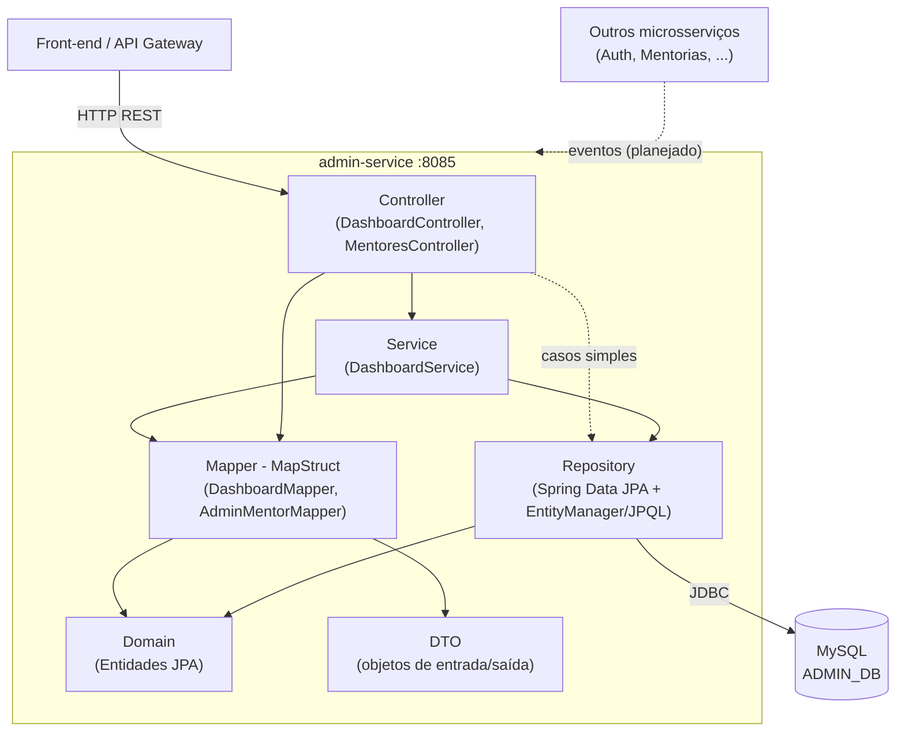
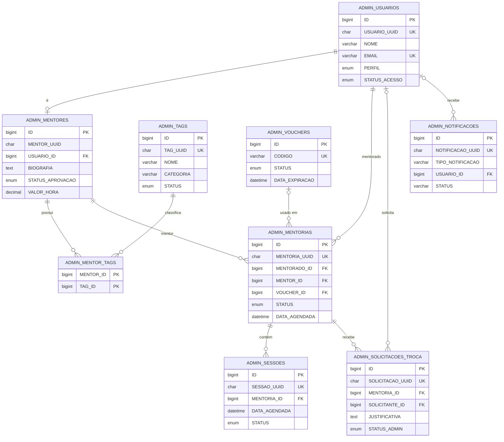

# uberhub-admin-service

Microsserviço de **administração** da plataforma **Uberhub** (plataforma de mentorias). Ele é responsável pelo painel administrativo: métricas do dashboard, aprovação de mentores, gestão de vouchers, tags, mentorias, sessões, solicitações de troca e notificações.

- **Porta:** `8085`
- **Banco:** MySQL (`ADMIN_DB`)
- **Nome da aplicação:** `admin-service`

---

## Sumário

- [Tecnologias](#tecnologias)
- [Arquitetura](#arquitetura)
- [Estrutura de pastas](#estrutura-de-pastas)
- [Modelo de dados](#modelo-de-dados)
- [Endpoints da API](#endpoints-da-api)
- [Como executar](#como-executar)
- [Testes](#testes)
- [O que já foi feito](#o-que-já-foi-feito)
- [Pendências e pontos de atenção](#pendências-e-pontos-de-atenção)

---

## Tecnologias

| Tecnologia | Versão | Uso |
|---|---|---|
| Java | 21 | Linguagem |
| Spring Boot | 4.1.2 | Framework base |
| Spring Web | — | API REST |
| Spring Data JPA / Hibernate | — | Persistência (ORM) |
| Spring Validation | — | Validação de DTOs (`@NotBlank`, `@Size`, `@NotNull`) |
| MySQL Connector/J | — | Driver do banco |
| Lombok | — | Redução de boilerplate (getters, builders, construtores) |
| MapStruct | 1.6.3 | Conversão Entidade ⇄ DTO |
| JUnit 5 + Mockito + AssertJ | — | Testes unitários |
| Maven (wrapper `mvnw`) | — | Build |

---

## Arquitetura

O serviço segue a **arquitetura em camadas** clássica do Spring:



### Responsabilidade de cada camada

| Camada | Pacote | Responsabilidade |
|---|---|---|
| **Controller** | `controller` | Expõe os endpoints REST, recebe requisições e devolve `ResponseEntity` com DTOs. |
| **Service** | `service` | Regras de negócio e orquestração (ex.: montar as métricas do dashboard). |
| **Repository** | `repository` | Acesso ao banco. Usa `JpaRepository` e, no dashboard, consultas JPQL via `EntityManager`. |
| **Domain** | `domain` | Entidades JPA mapeadas para as tabelas `ADMIN_*`. |
| **DTO** | `dto` | Objetos trafegados na API e nos eventos, com validações Bean Validation. |
| **Mapper** | `dto/mapper` | Interfaces MapStruct que geram, em tempo de compilação, a conversão entre entidades e DTOs. |
| **Utils** | `utils` | Enums de status/perfil usados pelas entidades. |

### Projeção local de dados (padrão de microsserviços)

O admin-service mantém **cópias locais (projeções)** de dados que pertencem a outros serviços — por exemplo, `AdminUsuarios` é uma *"projeção local de usuários do Auth service"*. Por isso as entidades possuem:

- um **UUID de origem** (`USUARIO_UUID`, `MENTOR_UUID`, `MENTORIA_UUID`...) que identifica o registro no serviço dono do dado;
- o campo **`ORIGEM_ATUALIZADO_EM`**, para saber quando o dado foi atualizado na origem.

A entidade **`AdminEventoProcessado`** dá suporte a **idempotência no consumo de eventos**: cada evento recebido é registrado pelo seu `EVENTO_UUID` (único), com status `PROCESSANDO → PROCESSADO | FALHA`, contador de tentativas e mensagem de erro (métodos `marcarComoProcessado()` e `registrarFalha()`). Os DTOs `NotificacaoEventoDTO` e `TokenDispositivoEventoDTO` já modelam a entrada desses eventos (notificações e token FCM de dispositivos).

---

## Estrutura de pastas

```
src/
├── main/
│   ├── java/iftm/microservice/admin_service/
│   │   ├── AdminServiceApplication.java      # Classe principal
│   │   ├── controller/
│   │   │   ├── DashboardController.java
│   │   │   └── MentoresController.java
│   │   ├── domain/                           # Entidades JPA
│   │   │   ├── AdminEventoProcessado.java
│   │   │   ├── AdminMentorTagId.java         # Chave composta (@Embeddable)
│   │   │   ├── AdminMentorTags.java
│   │   │   ├── AdminMentores.java
│   │   │   ├── AdminMentorias.java
│   │   │   ├── AdminNotificacoes.java
│   │   │   ├── AdminSessoes.java
│   │   │   ├── AdminSolicitacaoTroca.java
│   │   │   ├── AdminTags.java
│   │   │   ├── AdminUsuarios.java
│   │   │   └── AdminVoucher.java
│   │   ├── dto/
│   │   │   ├── AdminEventoProcessadoRequestDTO.java
│   │   │   ├── AdminMentorTagsDTO.java
│   │   │   ├── AdminMentoresDTO.java
│   │   │   ├── AdminMentoriasDTO.java
│   │   │   ├── AdminNotificacoesDTO.java
│   │   │   ├── AdminTagsDTO.java
│   │   │   ├── AdminVoucherDTO.java
│   │   │   ├── MetricasDashboardDTO.java
│   │   │   ├── NotificacaoEventoDTO.java
│   │   │   ├── TokenDispositivoEventoDTO.java
│   │   │   └── mapper/
│   │   │       ├── AdminMentorMapper.java
│   │   │       └── DashboardMapper.java
│   │   ├── repository/
│   │   │   ├── AdminEventoProcessadoRepository.java
│   │   │   ├── AdminMentorTagsRepository.java
│   │   │   ├── AdminMentoresRepository.java
│   │   │   ├── AdminMentoriasRepository.java
│   │   │   ├── AdminNotificacoesRepository.java
│   │   │   ├── AdminTagsRepository.java
│   │   │   └── DashboardRepository.java
│   │   ├── service/
│   │   │   └── DashboardService.java
│   │   └── utils/                            # Enums
│   └── resources/
│       └── application.properties
└── test/java/iftm/microservice/admin_service/
    ├── AdminServiceApplicationTests.java
    └── service/DashboardServiceTeste.java
dump.sql                                      # Script de criação e carga do ADMIN_DB
```

---

## Modelo de dados



Tabela independente: **`ADMIN_EVENTOS_PROCESSADOS`** (controle de idempotência de eventos).

### Enums (`utils`)

| Enum | Valores |
|---|---|
| `PerfilUsuario` | `MENTOR`, `MENTORADO`, `ADMIN` |
| `StatusAcesso` | `ATIVO`, `SUSPENSO`, `INATIVO` |
| `StatusAprovacao` (mentor) | `PENDENTE`, `APROVADO`, `REPROVADO`, `SUSPENSO` |
| `MentoriaStatus` | `PENDENTE`, `AGENDADA`, `EM_ANDAMENTO`, `CONCLUIDA`, `EXPIRADA`, `CANCELADA`, `NO_SHOW` |
| `StatusSessao` | `AGENDADA`, `EM_ANDAMENTO`, `CONCLUIDA`, `CANCELADA`, `NO_SHOW` |
| `StatusSolicitacaoTroca` | `PENDENTE`, `APROVADA`, `REPROVADA`, `CANCELADA` |
| `StatusTag` | `ATIVA`, `INATIVA` |
| `StatusVoucher` | `ATIVO`, `RESGATADO`, `EXPIRADO`, `CANCELADO` |
| `StatusProcessamento` | `PROCESSANDO`, `PROCESSADO`, `FALHA` |

---

## Endpoints da API

Base URL: `http://localhost:8085`

### Dashboard

#### `GET /admin/dashboard`

Retorna as métricas do painel administrativo.

| Campo | Como é calculado |
|---|---|
| `novosCadastros` | Usuários com `CRIADO_EM` nos últimos **7 dias** |
| `mentoriasPendentes` | Mentorias com status `PENDENTE` |
| `mentoriasRealizadasNoMes` | ⚠️ Valor fixo provisório (`5`) — ver pendências |
| `mentoresPendentes` | Mentores com `STATUS_APROVACAO = PENDENTE` |
| `vouchersAtivos` | Vouchers `ATIVO` e não expirados (sem data de expiração ou expiração futura) |
| `geradoEm` | Instante em que as métricas foram geradas |

Exemplo de resposta:

```json
{
  "novosCadastros": 12,
  "mentoriasPendentes": 4,
  "mentoriasRealizadasNoMes": 5,
  "mentoresPendentes": 3,
  "vouchersAtivos": 20,
  "geradoEm": "2026-11-18T14:32:10.123Z"
}
```

### Mentores

#### `GET /admin/mentors/pending`

Lista os mentores com status `PENDENTE`, ordenados por data de cadastro (mais antigos primeiro). A consulta usa `JOIN FETCH` para trazer usuário e tags em uma única query (evita o problema N+1).

```json
[
  {
    "id": 1,
    "mentorUuid": "4b8f...",
    "usuarioId": 10,
    "nome": "Maria Silva",
    "biografia": "Desenvolvedora backend...",
    "statusAprovacao": "PENDENTE",
    "valorHora": 80.00,
    "tags": [],
    "criadoEm": "2026-11-10T09:00:00"
  }
]
```

#### `POST /admin/mentors/{id}/approve`

Aprova um mentor pendente (muda o status para `APROVADO`).

| Situação | Resposta |
|---|---|
| Mentor aprovado | `200 OK` com o mentor atualizado |
| Mentor não existe | `404 Not Found` — "Mentor não encontrado com ID: {id}" |
| Mentor não está `PENDENTE` | `400 Bad Request` — "Apenas mentores com status PENDENTE podem ser aprovados." |

> O `MentoresController` está com `@CrossOrigin(origins = "*")`, liberando chamadas de qualquer origem.

---

## Como executar

### Pré-requisitos

- Java 21
- MySQL 8 rodando em `localhost:3306` (pode ser via Docker)

### 1. Subir o MySQL (exemplo com Docker)

```bash
docker run -d --name uberhub-mysql -p 3306:3306 -e MYSQL_ROOT_PASSWORD=<sua_senha> mysql:8
```

### 2. Criar o banco e carregar os dados

O arquivo [`dump.sql`](dump.sql) cria o banco `ADMIN_DB`, as tabelas e insere dados de exemplo:

```bash
docker exec -i uberhub-mysql mysql -uroot -p<sua_senha> < dump.sql
```

### 3. Configurar a conexão

Em [`src/main/resources/application.properties`](src/main/resources/application.properties), preencha a senha do banco:

```properties
spring.datasource.url=jdbc:mysql://localhost:3306/ADMIN_DB
spring.datasource.username=root
spring.datasource.password=<sua_senha>
```

O Hibernate está com `ddl-auto=update` (ajusta o schema automaticamente) e `show-sql=true` (mostra as queries no console).

### 4. Rodar a aplicação

```bash
# Linux / macOS / Git Bash
./mvnw spring-boot:run

# Windows (PowerShell / CMD)
mvnw.cmd spring-boot:run
```

A API ficará disponível em `http://localhost:8085`.

---

## Testes

```bash
./mvnw test
```

| Teste | O que verifica |
|---|---|
| `AdminServiceApplicationTests` | Se o contexto do Spring sobe (precisa do banco disponível). |
| `DashboardServiceTest` | Teste unitário com Mockito: cada contagem do `DashboardRepository` vai para o campo correto do `MetricasDashboardDTO`, e `geradoEm` é preenchido. Usa o mapper real gerado pelo MapStruct. |

---

## O que já foi feito

Linha do tempo resumida a partir do histórico de commits:

1. **Setup do projeto** — projeto Spring Boot criado, banco `ADMIN_DB` modelado, `dump.sql` com dados de exemplo (usuários, mentorias e feedbacks) e conexão configurada.
2. **Camada de domínio** — criação das entidades `AdminUsuarios`, `AdminMentores`, `AdminSolicitacaoTroca`, `AdminSessoes`, `AdminTags`, `AdminMentorTags` (com chave composta), `AdminNotificacoes`, `AdminMentorias`, `AdminVoucher` e `AdminEventoProcessado`, com constraints, índices e chaves estrangeiras nomeadas.
3. **Enums de status** — todos os ciclos de vida (usuário, mentor, mentoria, sessão, troca, tag, voucher, processamento de eventos).
4. **DTOs com validação** — DTOs de mentores, mentorias, tags, vouchers, notificações, eventos e métricas.
5. **Repositories** — repositórios JPA para mentores, mentorias, tags, mentor-tags, notificações e eventos processados, incluindo consultas customizadas com `JOIN FETCH`.
6. **Mentores** — `AdminMentorMapper` (MapStruct) e `MentoresController` com listagem de pendentes e aprovação.
7. **Dashboard** — `DashboardRepository` (consultas JPQL de contagem), `DashboardMapper`, `DashboardService`, `DashboardController` e teste unitário do service.
8. **Correções de bugs** gerais.

---

## Pendências e pontos de atenção

- [ ] **`mentoriasRealizadasNoMes`** está fixo em `5` no `DashboardService` — falta definir qual data caracteriza uma mentoria "realizada no mês" e criar a consulta.
- [ ] **Tags na listagem de mentores** — o `AdminMentorMapper` tem um `mapTags(Set<AdminTags>)`, mas a entidade expõe `mentorTags` (`List<AdminMentorTags>`), então o campo `tags` do DTO não é preenchido automaticamente. Falta um `@Mapping(target = "tags", source = "mentorTags")` com o método de conversão correspondente.
- [ ] **Teste do dashboard pode não rodar no `mvn test`** — o arquivo se chama `DashboardServiceTeste.java`, mas o Maven Surefire, por padrão, só executa arquivos terminados em `Test`, `Tests` ou `TestCase`. Renomear para `DashboardServiceTest.java`.
- [ ] **Tabela `ADMIN_VOUCHERS`** não está no `dump.sql` (hoje é criada pelo Hibernate via `ddl-auto=update`).
- [ ] **Tabelas sem entidade** — `ADMIN_FEEDBACKS_MENTORADO`, `ADMIN_FEEDBACKS_MENTOR` e `ANALYTICS_EVENTOS` existem no `dump.sql`, mas ainda não têm entidade/repository.
- [ ] **`AdminNotificacoesDTO`** — o construtor de conversão recebe outro `AdminNotificacoesDTO` em vez da entidade `AdminNotificacoes`.
- [ ] **Consumo de eventos** — os DTOs de evento e a tabela de idempotência existem, mas ainda não há listener/mensageria implementado.
- [ ] **Endpoints ainda não criados** — CRUD de vouchers, tags, gestão de usuários (suspensão/bloqueio), reprovação de mentores, decisão de solicitações de troca e consulta de sessões/notificações.
- [ ] **Segurança** — não há autenticação/autorização nos endpoints `/admin/**`, e o CORS está liberado para qualquer origem.
- [ ] **Senha do banco** — mover para variável de ambiente (ex.: `spring.datasource.password=${DB_PASSWORD}`) em vez de deixá-la no `application.properties`.
